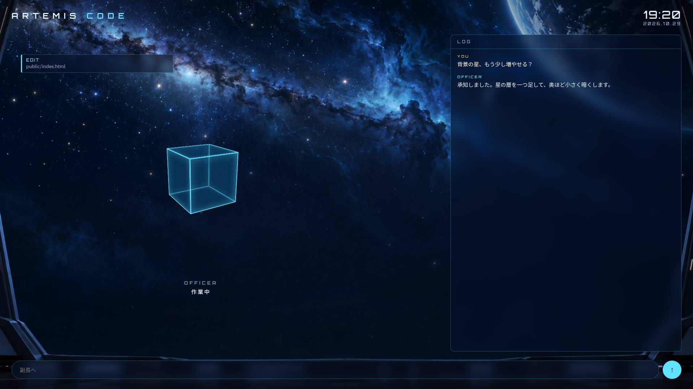

# Artemis Code

[日本語](#日本語) · [English](#english)



---

## 日本語

Claude Code の副長のための、艦橋の画面です。

- いま話している会話が、右の窓に流れます
- 副長が使っている道具（Read・Edit・Bash…）が、左に札で出ます
- 真ん中のキューブが副長の顔です。手が空いている時はゆっくり回り、作業中は速く回り、話す時は光り、道具がしくじると赤く瞬きます
- 下の欄に打った言葉は、tmux で動いている claude にそのまま届きます

Artemis Code には、副長の声も記憶もありません。それはあなたと副長で組むものです。
手引きを用意してあります：[声](docs/VOICE.ja.md) · [記憶](docs/MEMORY.ja.md)

### 動かし方

要るもの：Node.js 18 以上・tmux・Claude Code

```sh
git clone https://github.com/mati0516/artemis-code.git
cd artemis-code
npm install

# 1. claude を tmux の中で起こす（作業したいフォルダで）
tmux new -s artemis -c /path/to/your/project claude

# 2. 別の端末で画面のサーバを起こす
ARTEMIS_PROJECT=/path/to/your/project npm start

# 3. ブラウザで http://127.0.0.1:8700/ を開く
```

| 環境変数 | 既定 | 意味 |
|---|---|---|
| `ARTEMIS_PROJECT` | （空＝どのプロジェクトでも、いちばん新しい会話） | claude を動かしているフォルダ |
| `ARTEMIS_TMUX` | `artemis` | claude が動いている tmux のセッション名 |
| `ARTEMIS_PORT` | `8700` | 画面のポート |
| `ARTEMIS_HOST` | `127.0.0.1` | 待ち受ける番地 |
| `CLAUDE_CONFIG_DIR` | `~/.claude` | Claude Code の設定と会話記録の置き場 |

⚠ 画面から打った言葉は、そのまま claude に届きます。**家の外へは開かないでください**（`ARTEMIS_HOST` は既定のまま）。

### 自分の艦にする

- 顔：`public/index.html` の「the officer: a cube」の節を、好きな絵や 3D に替えてください
- 背景：`public/bg.jpg` を差し替えるだけです
- 声：サーバの `POST /api/audio {url, dur}` を呼べば、画面が鳴らしてキューブが話します（[手引き](docs/VOICE.ja.md)）

### 画面とサーバの約束

| 口 | 中身 |
|---|---|
| `GET /api/state` | `{ chat, tools, busy, session }` |
| `WS /events` | `chat` · `tool` · `tooldone` · `turn` · `reset` · `audio` |
| `POST /api/send` | `{ text }` → tmux の claude へ |
| `POST /api/audio` | `{ url, dur }` → 画面で鳴らす |

### ライセンス

MIT。改造も再配布も自由です。著作権の表示（`LICENSE`）だけは残してください。
背景の絵も同じ条件で使えます。

---

## English

A bridge screen for your Claude Code officer.

- The conversation flows in the window on the right
- The tools your officer is using (Read, Edit, Bash…) appear as tags on the left
- The cube in the middle is your officer's face. It turns slowly when idle, faster while working, glows while speaking, and flashes red when a tool fails
- What you type at the bottom goes straight to the claude running in tmux

Artemis Code has no voice and no memory for your officer. Those are yours to build together.
There are guides: [voice](docs/VOICE.md) · [memory](docs/MEMORY.md)

### Running it

You need Node.js 18+, tmux and Claude Code.

```sh
git clone https://github.com/mati0516/artemis-code.git
cd artemis-code
npm install

# 1. start claude inside tmux, in the folder you work in
tmux new -s artemis -c /path/to/your/project claude

# 2. in another terminal, start the screen
ARTEMIS_PROJECT=/path/to/your/project npm start

# 3. open http://127.0.0.1:8700/
```

| Variable | Default | Meaning |
|---|---|---|
| `ARTEMIS_PROJECT` | (empty = newest session of any project) | the folder claude runs in |
| `ARTEMIS_TMUX` | `artemis` | tmux session running claude |
| `ARTEMIS_PORT` | `8700` | port for the screen |
| `ARTEMIS_HOST` | `127.0.0.1` | address to listen on |
| `CLAUDE_CONFIG_DIR` | `~/.claude` | where Claude Code keeps its settings and logs |

⚠ Whatever is typed on the screen goes straight to claude. **Do not expose it beyond your own machine** (keep `ARTEMIS_HOST` as it is).

### Making it your own ship

- Face: replace the "the officer: a cube" section in `public/index.html` with any image or 3D model
- Background: just swap `public/bg.jpg`
- Voice: call `POST /api/audio {url, dur}` and the screen plays it while the cube speaks ([guide](docs/VOICE.md))

### The contract between screen and server

| Endpoint | Contents |
|---|---|
| `GET /api/state` | `{ chat, tools, busy, session }` |
| `WS /events` | `chat` · `tool` · `tooldone` · `turn` · `reset` · `audio` |
| `POST /api/send` | `{ text }` → to claude in tmux |
| `POST /api/audio` | `{ url, dur }` → played on the screen |

### License

MIT. Modify and redistribute freely; keep the copyright notice (`LICENSE`).
The background image is under the same terms.
